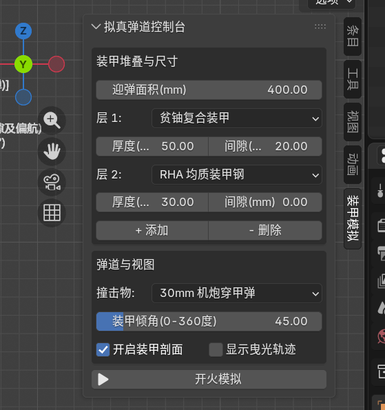
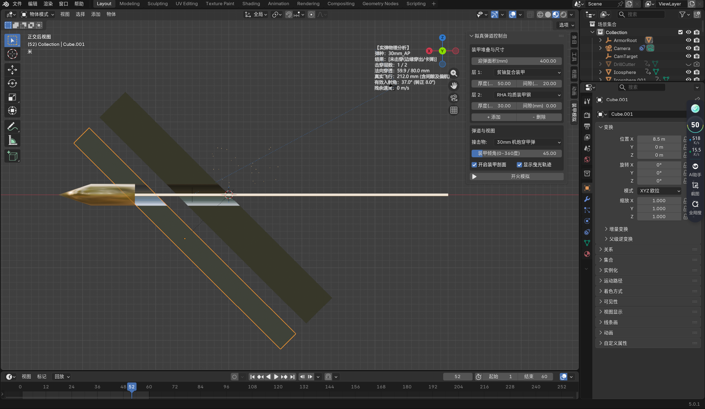

# Armor Collision Sim (装甲碰撞分析模拟系统)

基于 Blender Python API 开发的极高拟真装甲穿透、弹头与弹孔绝对同步的物理模拟插件。

## 🌟 功能简介
- 内置 14 种装甲材质与 26 种弹种。
- 自动计算穿甲深度、跳弹角度、残余速度。
- 动态生成弹孔，带火花与碎屑特效。

## 🛠️ 如何安装
1. 在本页面下载 `armor_sim.py` 代码文件。
2. 打开 Blender (3.6.0 以上版本)。
3. 点击 `编辑` -> `偏好设置` -> `插件`。
4. 点击右上角 `安装`，选择下载好的 `armor_sim.py`，并勾选启用。
5. 在 3D 视图中按 `N` 键，即可打开【装甲模拟】控制台。

## 📸 运行截图

